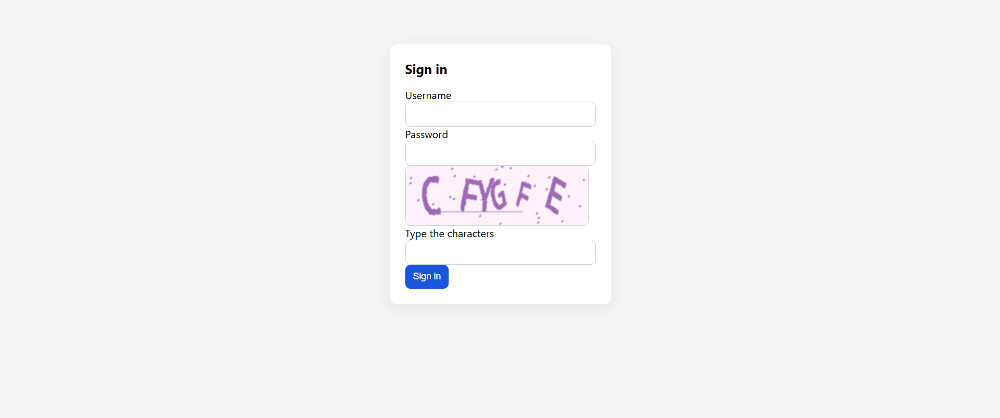

<p align="center">
  
</p>

<h1 align="center">captcha-login-web</h1>

<p align="center">
  A small Next.js demo built to show how to wire the my
  <a href="https://github.com/tahmasbi-dev/captcha-service"><strong>captcha-service</strong></a>
  into a login form.
</p>

---

## What it demonstrates

This demo walks through the full captcha workflow end to end:

1. **Fetch a challenge** – `POST /api/captcha/challenge` asks the captcha service for an image + `challengeId`.
2. **Solve it** – the user types the characters; `POST /api/captcha/solve` exchanges the correct answer for a short-lived, single-use `token`.
3. **Redeem it** – `POST /api/login` verifies the token server-to-server with the captcha service, then (in this demo) checks a hard-coded username/password pair.

The captcha challenge is **consumed on every verify**, so each login attempt needs a fresh challenge — the UI reloads one automatically after a failure.

> The captcha-service lives here: **https://github.com/tahmasbi-dev/captcha-service**

---

## Environment setup

Copy the example file and fill in real values:

```bash
cp .env.example .env.local
```

| Variable | Required | Purpose |
|---|---|---|
| `CAPTCHA_SERVICE_URL` | ✅ | Base URL of the running captcha-service. Defaults to `http://127.0.0.1:8000` when the service is started with `docker compose up -d --build` at the repo root. |
| `CAPTCHA_INTERNAL_API_KEY` | ✅ | Shared secret sent as the `X-Internal-Key` header on the server-to-server verify call. **Must be byte-for-byte identical** to `CAPTCHA_INTERNAL_API_KEY` in the captcha-service's own `.env`. |
| `DEMO_USERNAME` | ⚠️ demo only | Username accepted by `/api/login`. Defaults to `demo` if unset. |
| `DEMO_PASSWORD` | ⚠️ demo only | Password accepted by `/api/login`. Defaults to `demo` if unset. |

### Example `.env.local`

```env
# Base URL of the running captcha-service (docker compose up -d --build at repo root)
CAPTCHA_SERVICE_URL=http://127.0.0.1:8000

# MUST match CAPTCHA_INTERNAL_API_KEY in captcha-service's .env
CAPTCHA_INTERNAL_API_KEY=replace-with-the-same-key-as-the-service

# Demo credential check in the login route — replace with real auth
DEMO_USERNAME=demo
DEMO_PASSWORD=demo
```

---

## Running

```bash
pnpm install
pnpm dev          # http://localhost:3001
```

The captcha-service must be running and reachable at `CAPTCHA_SERVICE_URL`, otherwise `POST /api/captcha/challenge` returns a 500.